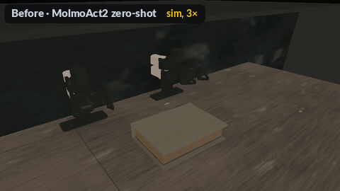
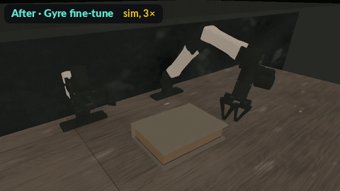
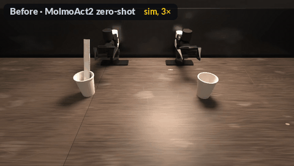
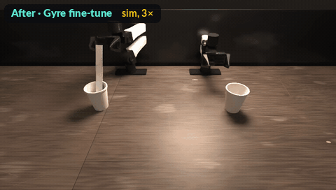

<h1 align="center">StationeryBench-Sim</h1>

<p align="center"><b>A <a href="#about-gyre">Gyre</a> pilot release</b></p>

<p align="center">Taking MolmoAct2 from 0% to 36% and 76% on two hard bimanual tasks, with ~263 L40S GPU-hours of fine-tuning</p>

<p align="center">
  <a href="LICENSE"></a>
  <a href="https://huggingface.co/xuxie1031/MolmoAct2-YAM-StationeryBench-Sim"></a>
  <a href="https://huggingface.co/datasets/xuxie1031/stationerybench-sim-eraser"></a>
  <a href="https://huggingface.co/datasets/xuxie1031/stationerybench-sim-ruler"></a>
  
</p>

<br>

<table>
  <tr>
    <th align="left">Task</th>
    <th align="left">Before: MolmoAct2 zero-shot</th>
    <th align="left">After: Gyre fine-tune</th>
  </tr>
  <tr>
    <td>Eraser from box</td>
    <td></td>
    <td></td>
  </tr>
  <tr>
    <td>Ruler handover</td>
    <td></td>
    <td></td>
  </tr>
</table>

Each row uses the same simulator seed from the sealed evaluation set. Physics simulation, played at 3× speed.

<br>

## Overview

This is the first public pilot from **Gyre**. It is an unofficial physics-simulation replica of two hard bimanual tasks from Robocurve's [StationeryBench](https://robocurve.github.io/stationerybench), `eraser_from_box` and `ruler_handover`, on the bimanual YAM robot.

On the real robot, the public MolmoAct2-BimanualYAM model completes neither task. In our replica it also scores 0%. Fine-tuned on synthetic demonstration data generated in the replica, with a small compute budget, the same model reaches 36% and 76% on seeds that were never used during development.

The release contains the task replicas, the A/B evaluation harness, the training recipe, the fine-tuned weights and the synthetic training data for the two tasks.

> [!NOTE]
> All results here are measured in simulation, on our replica, not on Robocurve's robot. This project is not affiliated with or endorsed by Robocurve or Ai2.

<br>

## Highlights

- **Gyre's fine-tune: 0% → 36%** on `eraser_from_box` and **0% → 76%** on `ruler_handover`, on 50 sealed seeds per task.
- **~263 L40S GPU-hours** for the whole 13-round fine-tuning lineage, about 66–105 H100-hour equivalents.
- That is **under 5%** of the ~2,300 H100-hours Ai2 used to adapt the base model to the YAM robot.
- **The real-robot failure reproduces in simulation:** zero-shot MolmoAct2 scored 0/20 on both tasks on the real YAM, and 0/50 in our replica.
- **Open:** task replicas, A/B evaluation harness, training recipe, weights and 6,467 synthetic training episodes.

<br>

## Results

### Sealed evaluation

| Task | Base model (zero-shot) | Gyre fine-tune | Change |
| --- | --- | --- | --- |
| `eraser_from_box` | 0 / 50 (0%) | **18 / 50 (36%)** | +36 points |
| `ruler_handover` | 0 / 50 (0%) | **38 / 50 (76%)** | +76 points |

- **95% intervals (Wilson):** base 0–7% on both tasks; fine-tune 24–50% on the eraser and 63–86% on the ruler.
- **Paired on the same seeds:** the fine-tune wins +18 / −0 and +38 / −0 episodes (exact McNemar p < 1e-5).
- **Seeds:** 3000000–3000049, never used for development or tuning.
- **Look:** `nominal2`, with lighting and materials aligned to Ai2's real YAM camera frames.
- **Episode length:** 120 s for the eraser (on a spring-return lid) and 66.7 s for the ruler.
- **Success:** stage 4 of the StationeryBench rubric.

Policy sampling is stochastic, so a re-run reproduces these numbers statistically rather than episode by episode. Stage histograms and development-set numbers are in [docs/RESULTS.md](docs/RESULTS.md).

### Real-robot reference

Robocurve's published real-robot comparison ([2026-09-10](https://openai.robocurve.org/stationerybench/)), 20 trials per task:

| Task | MolmoAct2 (zero-shot) | GPT-6 Astra |
| --- | --- | --- |
| `eraser_from_box` | 0 / 20 | 0 / 20 |
| `ruler_handover` | 0 / 20 | 1 / 20 |
| All five tasks | 0 / 100 | 7 / 100 |

Robocurve reports that in 47 of 100 MolmoAct2 trials the arms never left the start pose, including every eraser trial. In our replica the base model likewise never gets past stage 0 on the eraser. Simulation and real-robot numbers are not interchangeable, and our fine-tune has not been run on a real robot.

### Videos

Full-resolution videos are in the [model repository](https://huggingface.co/xuxie1031/MolmoAct2-YAM-StationeryBench-Sim/tree/main/videos):

- side-by-side comparisons of the base and the fine-tune on the same seed;
- a highlight reel;
- 9-episode grids of the first nine sealed seeds, not cherry-picked.

<br>

## Compute

The released checkpoint descends from the public base model through 13 fine-tuning rounds. Together they used about 263 NVIDIA L40S GPU-hours, measured from the training logs.

| Effort | Compute | Outcome |
| --- | --- | --- |
| **Gyre, this release** | **~263 L40S GPU-h** | **0% → 36% and 76%** on two new tasks |
| Ai2, adapting MolmoAct2 to YAM [1] | ~2,300 H100 GPU-h | the base model, 0% on these tasks |
| NVIDIA, GR00T N1.6 example [2] | 32–64 L40S GPU-h | one sim task, no zero-shot baseline |
| Robocurve, DreamZero on YAM data [3] | ~78 h on 8 × B200 | open-loop error only, no success rate |

[1] [MolmoAct2, arXiv 2605.02881](https://arxiv.org/abs/2605.02881) · [2] [Isaac Lab-Arena documentation](https://isaac-sim.github.io/IsaacLab-Arena/main/pages/example_workflows/static_manipulation/step_4_policy_training.html) · [3] [Robocurve model card](https://huggingface.co/robocurve/dreamzero-yam-molmoact2)

One H100-hour is roughly 2.5–4 L40S-hours for BF16 training, so our budget is about 66–105 H100-hour equivalents.

Most published fine-tuning results do not report GPU time at all. Our survey of about 65 results is in [docs/FINETUNE_COMPUTE_SURVEY.md](docs/FINETUNE_COMPUTE_SURVEY.md). Per-round numbers, and the separate accounting for data generation and evaluation, are in [docs/COMPUTE.md](docs/COMPUTE.md).

<br>

## Release

| Artifact | Link | Size |
| --- | --- | --- |
| Code | this repository | — |
| Fine-tuned weights | [MolmoAct2-YAM-StationeryBench-Sim](https://huggingface.co/xuxie1031/MolmoAct2-YAM-StationeryBench-Sim) | 21.8 GB |
| Eraser synthetic training data | [stationerybench-sim-eraser](https://huggingface.co/datasets/xuxie1031/stationerybench-sim-eraser) | 3,503 episodes, 48.7 GB |
| Ruler synthetic training data | [stationerybench-sim-ruler](https://huggingface.co/datasets/xuxie1031/stationerybench-sim-ruler) | 2,964 episodes, 32.3 GB |

<br>

## Repository layout

```text
envs/       task replicas, rubric evaluators, visual looks, RUBRICS.md
eval/       policy server, task runners, A/B driver, report
train/      fine-tuning wrapper, launchers, mixture builder
docs/       TRAINING, DATA, REPRODUCE, RESULTS, COMPUTE, FINETUNE_COMPUTE_SURVEY
scripts/    env.sh, eval.sh, repro_check.sh, serve.sh, download.sh
patches/    the one patch applied to the pinned MolmoAct2 checkout
```

MolmoAct2 is a dependency pinned at commit `allenai/molmoact2@6070080` and is not vendored. See [environment.md](environment.md).

<br>

## Quick start

```bash
git clone https://github.com/xuxie1031-droid/stationerybench-sim
cd stationerybench-sim
source scripts/env.sh

# download the base and fine-tuned weights into $GYRE_WORK/models
scripts/download.sh base finetuned

# smoke test: 10 sealed seeds per task, about 1 GPU-hour
scripts/repro_check.sh $GYRE_WORK/models/MolmoAct2-YAM-StationeryBench-Sim

# full sealed evaluation: 50 seeds per task
scripts/eval.sh all nominal2 3000000 50 --model $GYRE_WORK/models/MolmoAct2-YAM-StationeryBench-Sim --confirm
```

Setting up MolmoAct2 with our patch, the simulator environment and the robot assets is described in [docs/REPRODUCE.md](docs/REPRODUCE.md), together with the expected numbers, the data downloads and how to regenerate the data and re-run the training.

One 48 GB GPU (we used an NVIDIA L40S) runs the policy server and the simulator together. Run one simulator process per GPU.

<br>

## Notes and limitations

- **Simulation only.** The fine-tune has not been run on hardware, and sim and real success rates are not interchangeable.
- **Two of five tasks.** A third task, `middle_sticky_pad`, was co-trained in every round but is not released yet, because it has not reached our target success rate.
- **Effective data mixture.** A data-loader weighting effect made the sampled mixture differ from the configured one; for example, the configured 1:1 sim-to-real ratio was about 19:1 in the final round. The published recipe reproduces what was actually run, and both mixtures are listed in [docs/TRAINING.md](docs/TRAINING.md#configured-vs-effective-mixture).
- **No-clip inference.** Our demonstrations use joint ranges beyond the base model's action statistics, so actions must be un-normalized without clipping. Use `eval/host_server_yam_noclip.py`.

<br>

## About Gyre

**Gyre** helps robotics teams find out why a model fails on their task and fix it. We rebuild the task, reproduce the failure, fine-tune the model with targeted data, and measure the lift with rigorous A/B evaluation on held-out seeds.

This repository is our first public pilot. If you have a task your robot policy fails on, we would like to hear about it.

<br>

## License and acknowledgements

Our code is released under the [Apache License 2.0](LICENSE). Third-party notices are in [NOTICE](NOTICE).

- **[StationeryBench](https://robocurve.github.io/stationerybench)** by Robocurve (MIT): task definitions, setup text, instructions and the 0–4 rubric, copied with their copyright notice into [envs/RUBRICS.md](envs/RUBRICS.md).
- **[MolmoAct2](https://github.com/allenai/molmoact2)** by Ai2 (Apache-2.0): the simulation harness, the `bimanual_yam` agent, the policy server, the training code, and the base weights. Use them according to Ai2's [Responsible Use Guidelines](https://allenai.org/responsible-use).
- **Ai2 bimanual YAM datasets** (Apache-2.0): real-robot co-training data, referenced and not redistributed.
- **ManiSkill 3** (Apache-2.0) and **SAPIEN 3** (MIT), by Hillbot Inc. and the UCSD SU Lab.

<br>

## Citation

If you use this work, please also cite StationeryBench and MolmoAct2.

```bibtex
@misc{gyre2026stationerybenchsim,
  title  = {StationeryBench-Sim: A Physics-Simulation Replica and Fine-Tuning Recipe for Hard Bimanual Tasks},
  author = {{The Gyre authors}},
  year   = {2026},
  url    = {https://github.com/xuxie1031-droid/stationerybench-sim}
}
```
